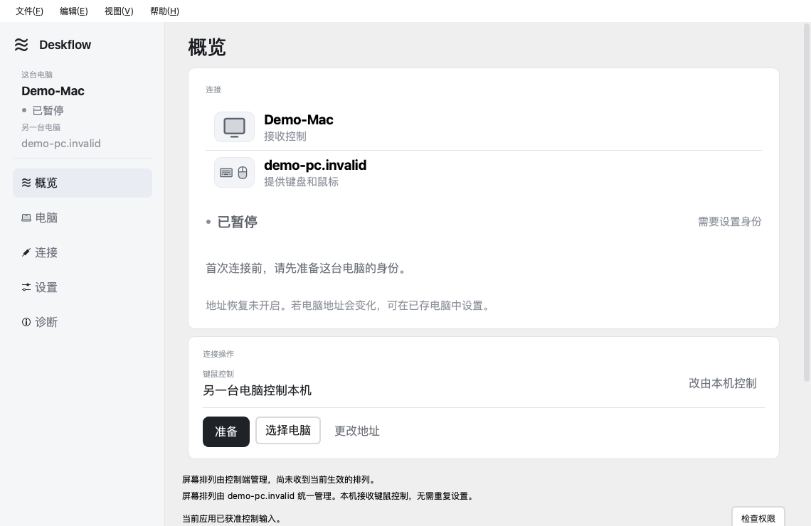
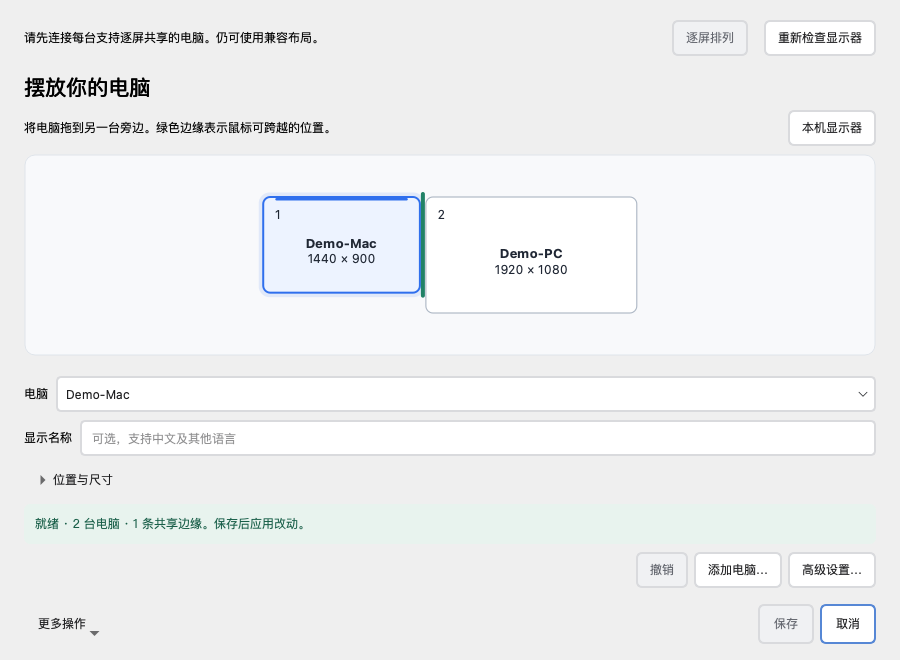
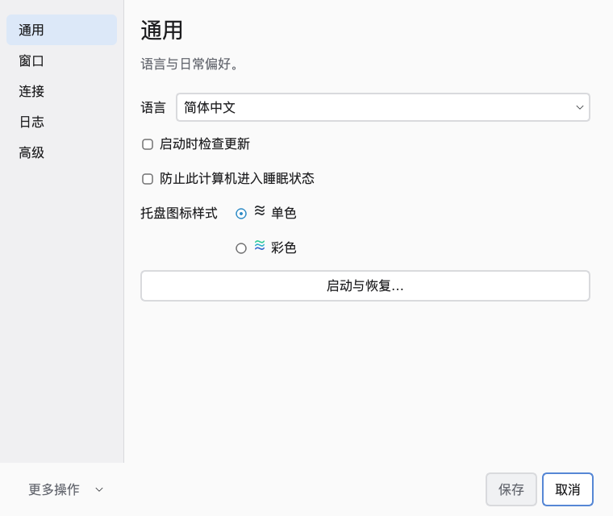

<!-- SPDX-FileCopyrightText: (C) 2026 Deskflow Enhanced contributors -->
<!-- SPDX-License-Identifier: MIT -->

# Deskflow Enhanced

**用一套键鼠，在 Mac 和 Windows 之间切换。** 这个独立维护的 [Deskflow](https://github.com/deskflow/deskflow) 衍生项目改进了连接流程、屏幕排列和异常恢复。提供安装预览、源码和构建说明。

[下载安装预览](https://github.com/MeliodasZHAO/deskflow-enhanced/releases) · [构建说明](#从源码构建)

**当前可下载版本是 `1.27.0.17` 预览版。** 在这一版上，首次创建身份后可能无法立即开始连接。创建后退出并重新打开 Deskflow，让程序重新读取身份，再尝试配对。首次设置、配对重试和加入新电脑的修复已在[候选分支](https://github.com/MeliodasZHAO/deskflow-enhanced/tree/release/preview)，新安装包正在做实机验收。



## 主要改进

| 场景 | 使用体验 |
| --- | --- |
| 连接与切换 | macOS 和 Windows 共用一套界面和状态逻辑。概览直接显示哪台电脑提供键鼠、哪台接收控制，以及当前能执行的操作。候选版默认优先使用简体中文。 |
| 首次设置 | macOS 集成键鼠权限检查和授权指引。支持发现局域网内的电脑、保存可信设备与手动输入地址。首次配对时核对对端身份。 |
| 屏幕排列 | 拖放电脑和显示器，调整相对位置，确认鼠标可跨越的边缘。排列支持草稿、撤销和保存。控制端负责应用排列，接收端可查看已生效的结果。 |
| 断线与恢复 | 同名旧会话占用时限次重试。共享核心失去响应时清除旧连接状态，并使用已保存的信任配置重连。主动暂停后保持停止。macOS 上，界面强退时同时清理其后台核心。 |

## 界面预览

截图来自程序实际界面，使用离线示例设备。

**屏幕排列** · 拖动不同尺寸的桌面并查看共享边缘。



**设置** · 常用偏好、连接、日志和高级选项集中在同一窗口。



## 从源码构建

需要支持 C++20 的编译器、CMake 3.24+、Qt 6.7+（含 SVG 和 Linguist Tools）及 OpenSSL 3.0+。按平台安装依赖后，在仓库根目录运行：

```sh
cmake -S . -B build -DCMAKE_BUILD_TYPE=Release -DDESKFLOW_CANDIDATE_BUILD=ON -DBUILD_INSTALLER=OFF -DBUILD_TESTS=OFF -DUPDATE_TRANSLATIONS=OFF
cmake --build build --config Release --parallel 2
```

`DESKFLOW_CANDIDATE_BUILD` 会生成使用独立设置的 `DeskflowCandidate`。如果 CMake 找不到依赖，可设置 `CMAKE_PREFIX_PATH` 和 `OPENSSL_ROOT_DIR`，指向本机对应的安装目录。macOS 要在系统设置中授予键鼠权限。Windows 的编译器和 vcpkg 配置见[平台构建说明](docs/dev/build.md)。

## 验证与来源

已在 Windows 提供键鼠、Mac 接收控制的组合上实测移动、单击和输入，并验证 Mac 核心挂起后自动恢复、应用强退后重新打开和主动暂停。高级逐屏排列需要两端支持对应功能并启用 TLS 与身份校验。反向物理键鼠、同时发生系统内存压力与 Windows 重启的组合场景，以及全屏和安全输入边界仍待覆盖。详细口径见[验证记录](docs/validation.md)。

基于 [Deskflow 上游源码](https://github.com/deskflow/deskflow/tree/c4eb0426f61e54278bf6d140411c5d218ea100e5)，感谢上游及其贡献者。保留上游版权声明、[GPL-2.0 许可证](LICENSE)、[OpenSSL 例外](LICENSES/LicenseRef-OpenSSL-Exception.txt)及各组件的[许可证](LICENSES/)。开发过程中使用了 OpenAI Codex（含 GPT‑6.1 Sol）辅助实现和测试。

## English summary

Deskflow Enhanced is an independently maintained derivative of Deskflow for sharing a keyboard and mouse between computers. It adds a common macOS and Windows connection interface, macOS permission guidance, nearby-device discovery and trust checks, a display arrangement editor, and recovery after stale sessions or an unresponsive core. This repository contains source code. The screenshots use offline demo devices. See [build instructions](docs/dev/build.md) and [validation notes](docs/validation.md).

The current download is preview `1.27.0.17`. If the app stays paused after creating its local identity, quit and reopen it, then try pairing again. Installers with the fix are undergoing device testing.
